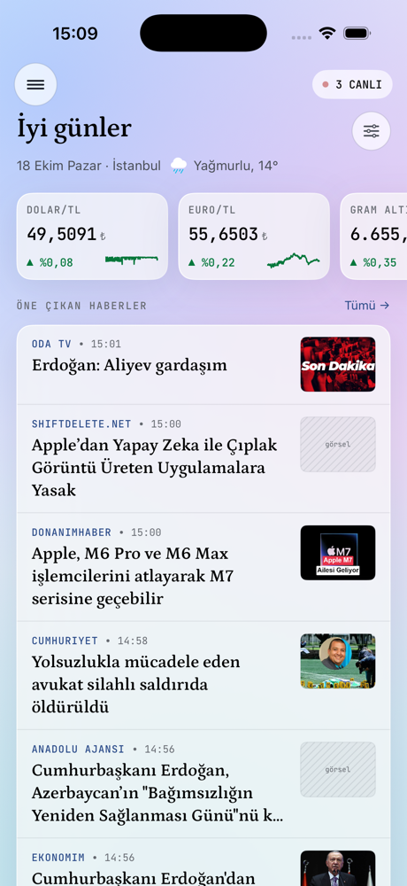
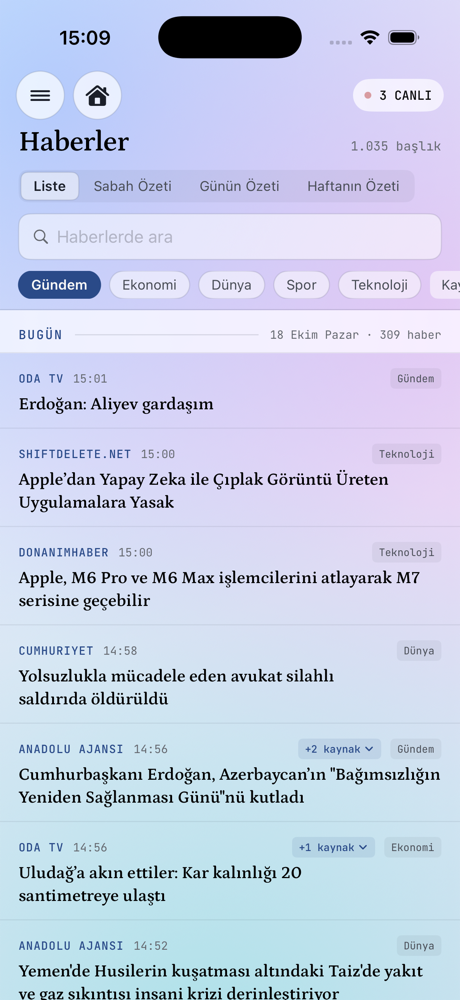
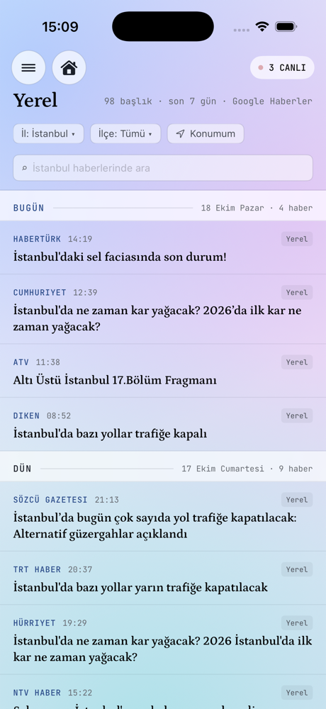
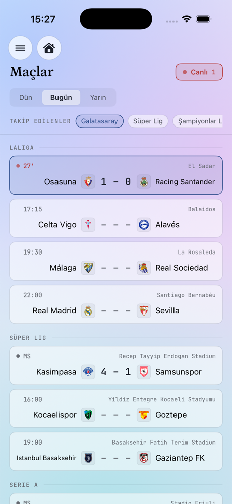
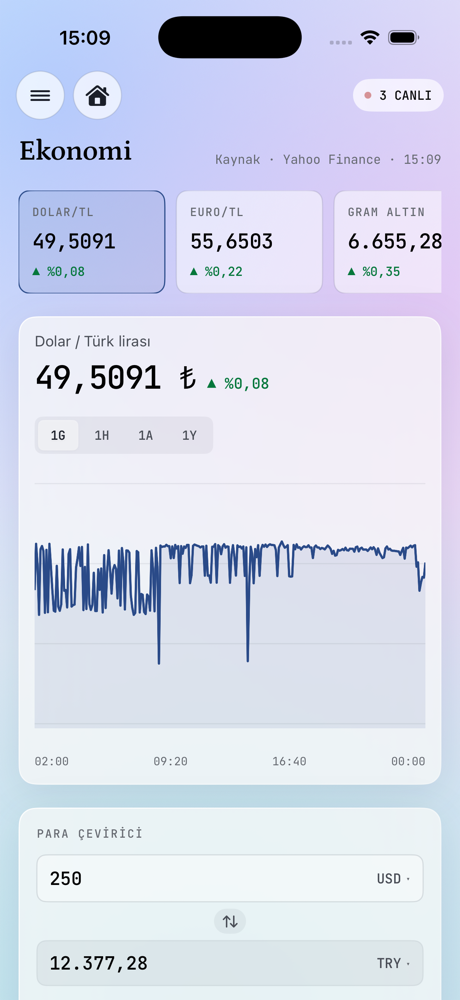
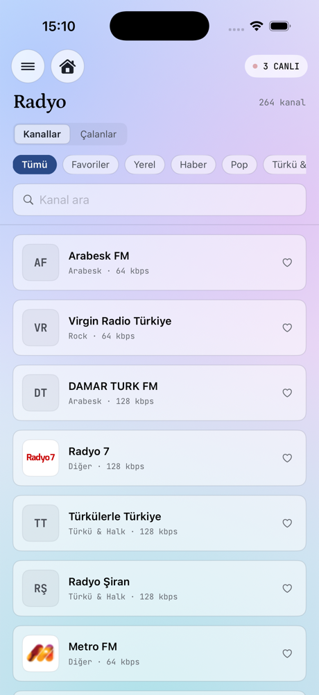
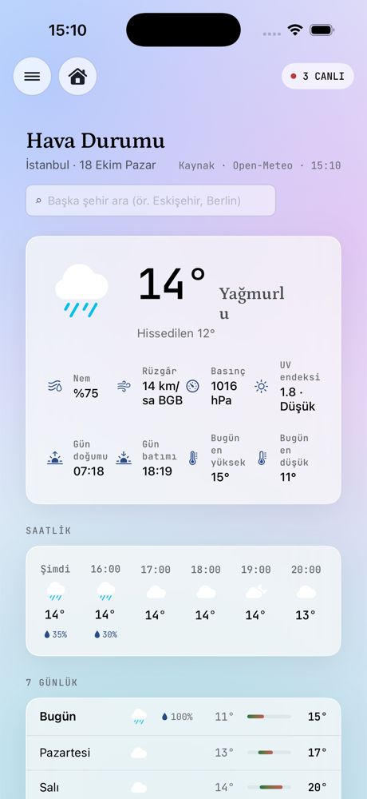
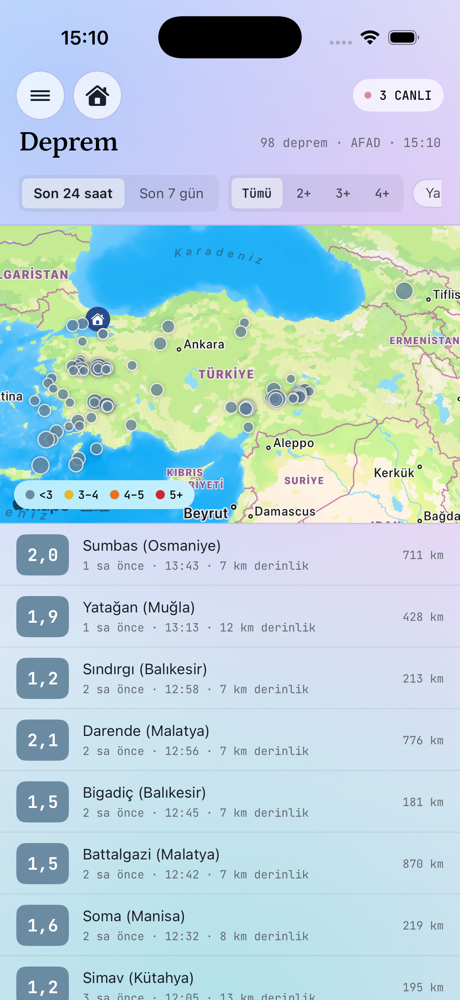
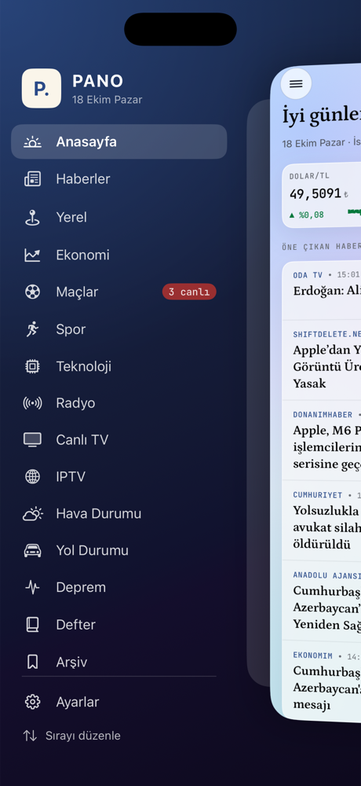

# PANO

**Gündemin panosu.** Haberler, yerel haberler, piyasalar, maçlar, radyo, canlı TV, hava ve yol durumu, depremler,
takvim ve not defteri tek uygulamada. macOS ve iPhone için, SwiftUI ile yazılmış yerel (native) bir uygulama.

Hiçbir hesap, abonelik ya da API anahtarı gerektirmez. Bütün veriler herkese açık kaynaklardan gelir.

<p align="center">
  
  
  
</p>

## Neler var?

### 📰 Haberler
- **24 kaynak** tek listede: AA, BBC Türkçe, Cumhuriyet, Hürriyet, NTV, TRT Haber, Sözcü, Habertürk, Bloomberg HT,
  Webtekno ve diğerleri. Hangilerinin görüneceğini Ayarlar'dan seçersiniz.
- **Aynı haberi katlama:** Birçok sitenin verdiği aynı haber tek satırda, "+3 kaynak" etiketiyle görünür.
- **Kaldığın yer:** Son okumanızdan beri gelen haberler işaretlenir.
- **Okuyucu:** Haber, reklamsız ve sade biçimde uygulamanın içinde açılır.
- **Özetler:** Sabah Özeti, Günün Özeti (en çok konuşulan konular) ve Haftanın Özeti.
- **Bildirimler:** Anahtar kelime bildirimleri, sabah ve akşam özeti.
- **Ayrı sekmeler:** Spor (futbol, basketbol, voleybol, tenis…) ve Teknoloji.
- **Arşiv ve Defter:** Haberleri saklayın, günlük not ve yapılacaklar tutun.

### 📍 Yerel
Bulunduğunuz il ya da ilçenin son bir haftalık haberleri. Yer, cihazın konumundan bulunur ya da 81 il ve 973 ilçe
arasından seçilir.

### 💹 Ekonomi
- Dolar, euro, gram altın, BIST, Brent, Bitcoin, grafikleri ve para çevirici.
- 81 ilin akaryakıt fiyatları ve zam/indirim bildirimi.

### ⚽ Maçlar
- Süper Lig, Şampiyonlar Ligi, Avrupa Ligi, Premier Lig, LaLiga, Serie A ve milli maçlar.
- Canlı skor ve gol bildirimi.
- **Takımım** kartı: puan durumu, son beş maç, sıradaki maç.

### 📻 Radyo ve 📺 TV
- **Radyo:** Yüzlerce Türk radyosu ve illere göre yerel radyolar. Çalan şarkının adı ve kapağı görünür, Apple Music
  bağlantısı ve şarkı geçmişi tutulur.
- **Canlı TV ve IPTV:** Türk kanalları ve dünyanın her yerinden ücretsiz yayınlar. Kapalı yayınlar kendiliğinden
  gizlenir. Mini oynatıcı ve uyku zamanlayıcısı var.

### 🌦 Hava, 🚗 Yol, 🌍 Deprem, 📅 Takvim
- **Hava Durumu:** Anlık durum, saatlik ve 7 günlük tahmin.
- **Yol Durumu:** Kayıtlı rotalarınızda canlı trafik ve gecikme süresi.
- **Deprem:** AFAD verileriyle harita ve liste, yakınınızdaki depremler için bildirim.
- **Takvim:** Resmi tatiller, arifeler ve köprü günü önerileri.
- **Şehrim:** Nöbetçi eczaneler, kesinti duyuruları, belediye ve acil numaralar.

<p align="center">
  
  
  
</p>
<p align="center">
  
  
  
</p>

## Mac ve iPhone

| | Mac | iPhone |
|---|---|---|
| Klasör | [`mac/`](mac) | [`ios/`](ios) |
| Gereken | macOS 14+, Swift 5.9 | iOS 17+, Xcode, [XcodeGen](https://github.com/yonaskolb/XcodeGen) |
| Gezinme | Kenar çubuğu, menü çubuğu penceresi | Animasyonlu yan menü (☰) |

Mac sürümünde ayrıca menü çubuğu penceresi, açık/koyu tema, beş renk teması, "Cam" (buzlu cam) ve "Klasik" arayüz
stilleri vardır. iPhone sürümü aynı kaynak kodun telefona uyarlanmış hâlidir (`ios/PANO/Shared`).

## Derleme

**Mac**

```sh
cd mac
./scripts/build_app.sh        # → build/PANO.app
open build/PANO.app
```

**iPhone**

```sh
cd ios
xcodegen generate
open PANO.xcodeproj           # Signing & Capabilities'ten kendi ekibinizi seçip telefona çalıştırın
```

Ayrıntılar: [`mac/README.md`](mac/README.md) · [`ios/README.md`](ios/README.md)

## Veri kaynakları

| Konu | Kaynak |
|---|---|
| Haberler | Yayın kuruluşlarının RSS beslemeleri |
| Yerel haberler | Google Haberler araması |
| Piyasalar | Yahoo Finance |
| Akaryakıt | Petrol Ofisi |
| Maçlar | ESPN |
| Hava durumu | Open-Meteo |
| Deprem | AFAD |
| Radyo | radio-browser.info, Online Radio Box |
| Şarkı bilgisi | iTunes Search |
| TV / IPTV | [iptv-org](https://github.com/iptv-org/iptv) |
| Resmi tatiller | Nager.Date |
| Trafik | Apple Haritalar |
| İl ve ilçeler | turkiyeapi.dev |

Bu kaynakların bir kısmı resmî olmayan uç noktalardır; haber vermeden değişebilirler.
